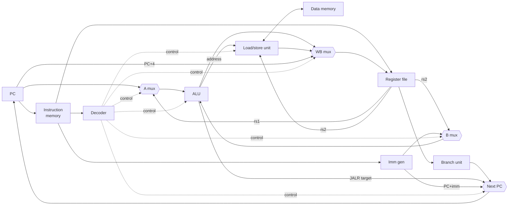

# RV32I Single-Cycle CPU

A single-cycle RISC-V processor implementing the full **RV32I** base integer
instruction set, written in plain Verilog-2005 and verified in simulation with
Icarus Verilog.

Every instruction completes in one clock cycle. The design is split into small,
self-contained modules so that each piece (ALU, decoder, register file, …) can
be read and understood on its own.

## Features

- All 37 RV32I computational, memory and control-flow instructions
- `FENCE` (no-op), `ECALL` / `EBREAK` (halt the simulation)
- Illegal-instruction detection: an illegal instruction never changes state
- Byte, halfword and word loads/stores with sign and zero extension
- Self-checking test programs, run with a single `make test`
- A small Python assembler, so no RISC-V GCC toolchain is required
- Instruction trace and VCD waveform dumps for debugging

## Datapath



Only three things update on the clock edge: the **PC**, the **register file**
and the **data memory**. Everything else is combinational.

## Repository layout

```
.
├── rtl/                    Synthesizable design
│   ├── riscv_defs.vh       Opcode and control-signal encodings
│   ├── riscv_core.v        Core datapath (fetch → decode → execute → mem → WB)
│   ├── decoder.v           Main control unit
│   ├── alu.v               Arithmetic / logic unit
│   ├── regfile.v           32 × 32-bit register file, x0 hardwired to 0
│   ├── imm_gen.v           Immediate generation for I/S/B/U/J formats
│   ├── branch_unit.v       Branch condition evaluation
│   ├── load_store_unit.v   Byte/halfword lane steering and extension
│   ├── imem.v              Instruction memory (simulation model)
│   ├── dmem.v              Data memory (simulation model)
│   └── riscv_top.v         Core + memories
├── tb/
│   └── tb_riscv.v          Testbench: runs a program, reports pass/fail
├── sw/                     Test programs (RISC-V assembly)
│   ├── test_alu.S
│   ├── test_mem.S
│   ├── test_branch.S
│   └── test_sort.S         Bubble sort + Fibonacci
├── tools/
│   └── asm.py              Minimal RV32I assembler → hex
└── Makefile
```

## Getting started

### Prerequisites

- [Icarus Verilog](https://steveicarus.github.io/iverilog/) (`brew install icarus-verilog` or `apt install iverilog`)
- Python 3
- Optional: [GTKWave](https://gtkwave.sourceforge.net/) for viewing waveforms

### Run the tests

```bash
make test
```

```
test_alu       PASS  (119 cycles)
test_branch    PASS  (68 cycles)
test_mem       PASS  (70 cycles)
test_sort      PASS  (479 cycles)
```

### Debugging a program

```bash
make trace T=test_branch   # print every executed instruction
make wave  T=test_branch   # dump build/wave.vcd, then: gtkwave build/wave.vcd
```

Trace output shows the PC, instruction and any register or memory write:

```
     0  pc=00000000  instr=00100193  x3 <= 00000001
     1  pc=00000004  instr=00500293  x5 <= 00000005
     2  pc=00000008  instr=00500313  x6 <= 00000005
     3  pc=0000000c  instr=00628463
     4  pc=00000014  instr=00200193  x3 <= 00000002
```

## Writing your own programs

Drop a `.S` file into `sw/` and `make test` will pick it up automatically.

The assembler supports every RV32I instruction, labels, `#` comments and the
common pseudo-instructions: `nop li mv not neg seqz snez j jr ret call beqz bnez
bltz bgez blez bgtz bgt ble bgtu bleu`.

```bash
python3 tools/asm.py sw/myprog.S -o build/myprog.hex -l   # -l prints a listing
```

**Test convention:** a program ends with `ecall`. The testbench then reads
`a0` (x10): `0` means pass, any other value is reported as the number of the
failing check. The included tests keep the current check number in `gp` and
copy it into `a0` on failure:

```asm
    li   gp, 1          # check #1
    li   t0, 5
    addi t1, t0, 7
    li   t2, 12
    bne  t1, t2, fail

pass:
    li   a0, 0
    ecall
fail:
    mv   a0, gp
    ecall
```

## Memory map

Instruction and data memories are separate (Harvard architecture), each 4 KB
and both starting at address `0x0000_0000`. The PC resets to `0x0000_0000`.

## Supported instructions

| Type | Instructions |
|------|--------------|
| R    | `add sub sll slt sltu xor srl sra or and` |
| I    | `addi slti sltiu xori ori andi slli srli srai` |
| Load | `lb lh lw lbu lhu` |
| Store| `sb sh sw` |
| Branch | `beq bne blt bge bltu bgeu` |
| Jump | `jal jalr` |
| Upper| `lui auipc` |
| System | `fence` (no-op), `ecall` / `ebreak` (halt) |

## Limitations

- No CSRs, interrupts or exceptions: `ECALL`/`EBREAK` stop the simulation
  instead of trapping.
- Misaligned loads and stores are not detected.
- The memories are simulation models; they are not written for FPGA
  block-RAM inference.

## Roadmap

- [ ] 5-stage pipeline with forwarding and hazard detection
- [ ] M extension (multiply / divide)
- [ ] Zicsr and machine-mode traps
- [ ] Run the official [riscv-tests](https://github.com/riscv-software-src/riscv-tests) suite
